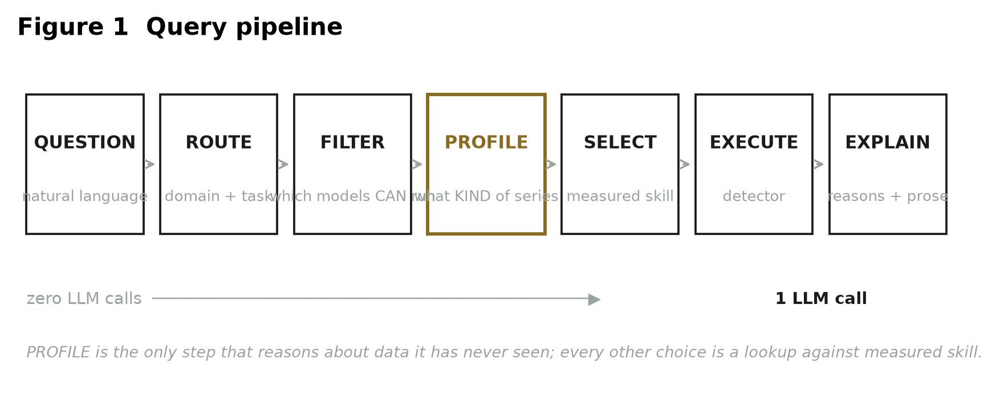
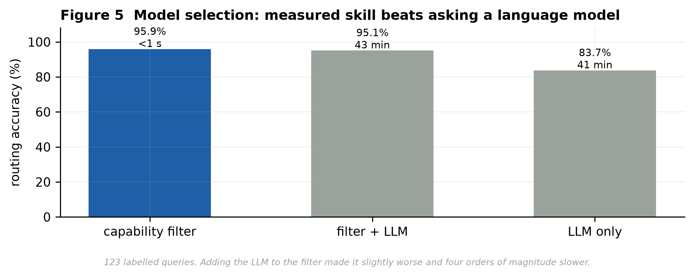
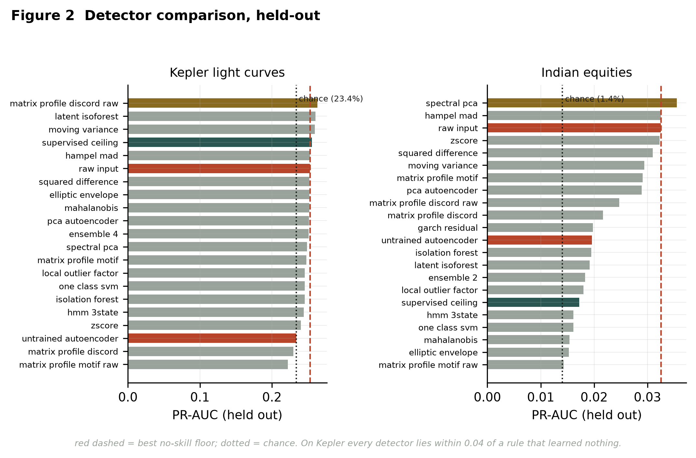
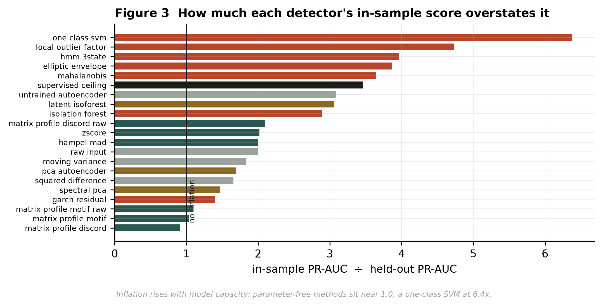
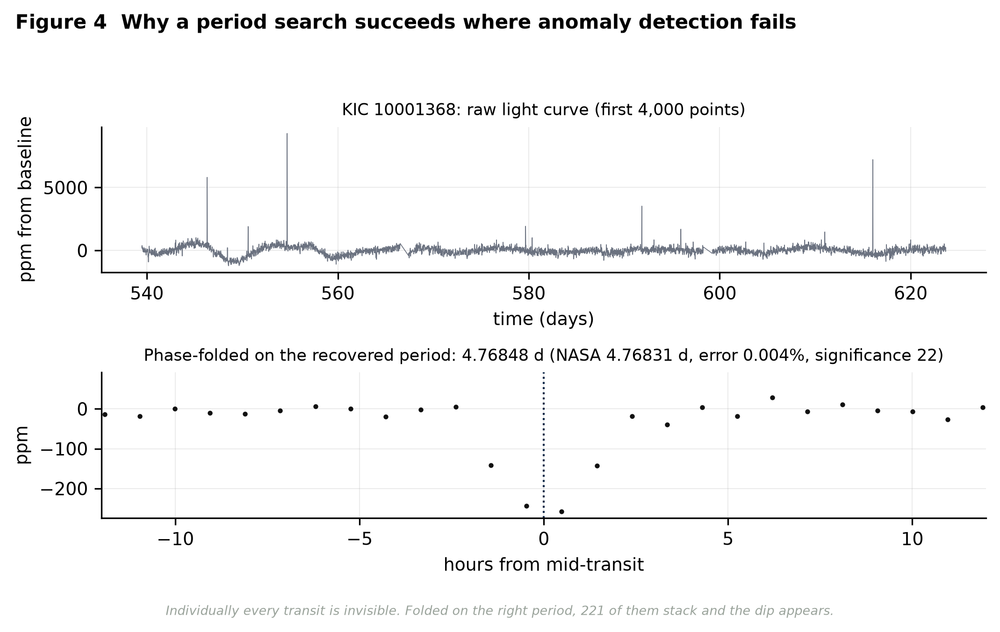

# Multi-Agent Time-Series Analysis

An agent that answers natural-language questions about time series by **choosing its model from a registry of measured out-of-sample skill**, instead of asking a language model to pick one.

Ask *"has anything unusual happened to Reliance this year?"* or *"is there a planet around KIC 11446443?"* and the same system routes the question to a task, checks which registered models can actually accept that data, ranks them by how well they scored on held-out folds, runs the winner, and explains the result in plain language.

Two domains are covered end to end — Kepler light curves labelled from **NASA transit ephemerides**, and Indian equity returns labelled from a **pre-registered event calendar**. Neither set of labels is derived from the series being scored.

---

## Headline results

Everything below is **held out**. Nothing is scored on data it was fitted on, and no point adjustment is applied.

| Question | Result |
|---|---|
| Can a capability filter route better than an LLM? | **95.9%** vs **83.7%**, and in under a second against 41 min |
| Does combining them help? | No — **95.1%**, worse than the filter alone |
| Do 22 anomaly detectors beat a rule that learns nothing? | Barely. Best margin **+0.0102 PR-AUC** on Kepler, **+0.0030** on equities |
| How much do in-sample scores overstate skill? | From **0.9x** (matrix profile) to **6.4x** (one-class SVM) |
| Does regime-conditional VaR pass its coverage tests? | Yes (Kupiec p=0.27) where the unconditional model is **rejected** (p=0.007) |
| Do the forecasting models beat a naive baseline? | **No.** Naive RMSE **36.2**; XGBoost 50.5, GPR 65.8, ARIMA 123.7 |
| Can a task-specific method succeed where generic ones fail? | Yes — Box Least Squares recovers **60.9%** of orbital periods |

The negative results are the point. Three of the seven rows are failures, and they were kept because a benchmark that only reports its wins cannot be used to choose a model.

---

## Model selection



The registry holds **20 models over 10 tasks and 4 domains**; 16 carry a measured held-out score. Each declares what it needs (sampling rate, minimum length, whether gaps are tolerated), what it returns, and how it actually scored.

Selection is a filter, not a generation step: a question is mapped to a task, models that cannot accept the data are eliminated on their declared constraints, and the survivors are ranked by measured skill. A language model is used for *explanation*, never for choosing.



Tested on **123 labelled queries** — canonical phrasings, paraphrases, adversarial near-misses, and 10 questions no registered model can answer, where the correct behaviour is to decline.

| Strategy | Accuracy | Wall clock |
|---|---|---|
| Capability filter | **95.93%** | 0.0 s |
| Filter + LLM (hybrid) | 95.12% | 43.0 min |
| LLM only | 83.74% | 41.0 min |

Adding the language model to a working filter made it *worse*. Reproduce with `python -m evaluation.run_selection`.

---

## Anomaly detection across two domains



22 detectors in six families — threshold rules, distance and density methods, matrix profile, spectral decomposition, state-space models, and neural autoencoders — run on both domains through one interface.

| | Kepler | Indian equities |
|---|---|---|
| Data | 40 targets, 384,281 windows | 50 names, 1,911 days |
| Held-out windows | 124,782 | 568 |
| Prevalence | 23.4% | 1.41% |
| No-skill floor (PR-AUC) | 0.2528 | 0.0325 |
| Best detector | `matrix_profile_discord_raw` **0.2630** | `spectral_pca` **0.0355** |
| Supervised ceiling | 0.2555 | 0.0172 |

Two findings worth stating plainly:

- On Kepler, **three unsupervised detectors outscore a supervised model that was given the labels.** The features do not separate transits, so extra information does not help.
- On equities the supervised ceiling (0.0172) falls **below the no-skill floor** (0.0325). With 8 positive windows in the test fold, a supervised model has nothing to learn from.

### Why in-sample numbers cannot be trusted



Inflation = in-sample PR-AUC divided by held-out PR-AUC:

| Detector | Inflation |
|---|---|
| `matrix_profile_discord` | 0.91x |
| `hampel_mad` | 1.99x |
| `zscore` | 2.02x |
| `isolation_forest` | 2.89x |
| `local_outlier_factor` | 4.73x |
| `one_class_svm` | **6.37x** |

It tracks **capacity, not skill**. Scored transductively, the one-class SVM looked like the strongest equity detector at 4.62x lift; held out it manages 1.14x. Any leaderboard built without a split would have crowned it.

### The representation, not the algorithm



A transit repeats hundreds of times in one light curve, which makes it the *least* unusual feature of that curve — generic anomaly detection is searching for the opposite of what is there. Changing the question rather than the model fixes it. Box Least Squares folds the series on thousands of candidate periods and stacks every repetition:

| Metric | Value |
|---|---|
| Significant peak found | 91.4% |
| Period recovered within 1% | **60.9%** |
| Median period error | 0.005% |
| Harmonic locks (2x or half the true period) | 33.6% |

---

## Quantitative risk

`quant/` and `finance/risk_profile.py` hold the risk work, built around the idea that a single unconditional distribution is the wrong model for returns.

**Regimes.** A Mahalanobis turbulence index (Kritzman & Li, 2010) over a 252-day trailing covariance, plus a Gaussian HMM. Turbulence runs **5.59x higher** on pre-registered event days. Both *filtered* (forward-recursion) and *smoothed* (Viterbi) states are exposed, and the difference is documented: smoothed states use future data and must never be used for backtesting.

**Value-at-Risk.** Regime-conditional VaR passes both coverage tests that the unconditional model fails:

| Model | Kupiec POF | Christoffersen |
|---|---|---|
| Unconditional | rejected, p=0.0068 | rejected, p=0.0005 |
| Regime-conditional | **pass, p=0.273** | **pass, p=0.861** |

**Multi-horizon.** Propagating the Markov transition matrix forward gives a 10-day VaR of **-5.00%**, against **-6.31%** from the square-root-of-time rule — that scaling overstates the tail by **20.7%** because it assumes i.i.d. returns that regime persistence contradicts.

**Attribution.** Anomalies are decomposed into systematic and idiosyncratic components via beta against the index, so a flagged day can be attributed to a market-wide move or to the name itself. An event study over the pre-registered calendar gives **+0.32%** at 1 day (t=3.37) and **+0.58%** at 21 days (t=2.25) on sign-adjusted forward returns.

---

## Layout

```
agents/           model registry, capability selector, LangGraph nodes, answer guards
anomaly/          detector interface, 22 detectors, splits, metrics, data audit, profiler
quant/            turbulence, HMM regimes, VaR/ES, Kupiec + Christoffersen, Markov horizons
finance/          price data, risk profile, sentiment, universe construction, forecasting
astronomy/        Kepler loading, KOI catalogue labels, Box Least Squares, embeddings
solar/            NOAA X-ray flux, flare features, Hawkes process
evaluation/       query set, selection experiment, figures, committed results
rag/              embeddings and vector store for the explanation layer
pages/ views/ dashboard/    Streamlit interface
tests/            integration tests
```

## Getting started

```bash
python -m venv .venv
.venv\Scripts\activate          # Windows; source .venv/bin/activate elsewhere
pip install -r requirements.txt
streamlit run app.py
```

No API key is needed for the analysis — every model runs locally on free data (yfinance, NASA Exoplanet Archive, NOAA SWPC). A key is only read from the environment (`OPENAI_API_KEY` / `ANTHROPIC_API_KEY`) if you want LLM-written explanations; without one the system still answers, using templates.

## Reproducing the results

```bash
python -m evaluation.run_selection      # routing table (~45 min with the LLM arms)
python -m anomaly.grid                  # detector grid on both domains
python -m evaluation.report_figures     # regenerate every figure above
python -m astronomy.transit_search      # Box Least Squares period recovery
pytest                                  # integration tests
```

Committed results live in `evaluation/results/` — `anomaly_grid.json`, `selection_all.json` and the figures — so every number in this README can be checked without re-running anything.

## Design notes

**Labels never come from the series being scored.** An earlier version labelled a window "transit" by thresholding its own depth, then evaluated detectors that look for deep dips. Measured inflation from that circularity: **+0.11 AUC**. Labels now come from NASA ephemerides (T0 + nP) and a pre-registered event calendar fixed before any detector ran.

**Solar is deliberately excluded from the anomaly benchmark.** A flare's class is *defined* by an X-ray flux threshold, so detecting flares from X-ray flux cannot fail. It is kept as a forecasting domain, where the question is genuinely open.

**No point adjustment.** Under the point-adjustment protocol common in the time-series anomaly literature, a *random* score reaches state-of-the-art F1 (Kim et al., AAAI 2022). Raw PR-AUC is reported instead, floored at the base rate.

**The data was audited before any result was recorded.** Wu & Keogh's four benchmark flaws — triviality, unrealistic anomaly density, mislabelled ground truth, run-to-failure bias — are checked by `anomaly/audit.py` on both datasets. Kepler raises one warning on anomaly density; it is reported rather than hidden.

**Splits are stratified by prevalence.** A naive temporal split gave 17.9% versus 42.8% positive rates across folds, which makes the comparison meaningless. Group-stratified splitting closes that gap to 0.0145.

## Known limitations

- Kepler is 40 targets in the detector grid; the Box Least Squares run covers 440.
- The equity test fold contains **8 positive windows**. Wide confidence intervals; treat the equity column as directional.
- Astronomy caching and Box Least Squares are implemented but not yet reachable from the chat interface.
- The local LLM backend takes 3–8 minutes per answer. A hosted backend is needed for a live demo.
- The planned ablation (bare LLM vs. retrieval vs. full agent) has not been run.

## Licence

MIT — see [LICENSE](LICENSE). Data comes from public sources (NASA Exoplanet Archive, NOAA SWPC, yfinance) under their own terms; no vendor data is redistributed here.
